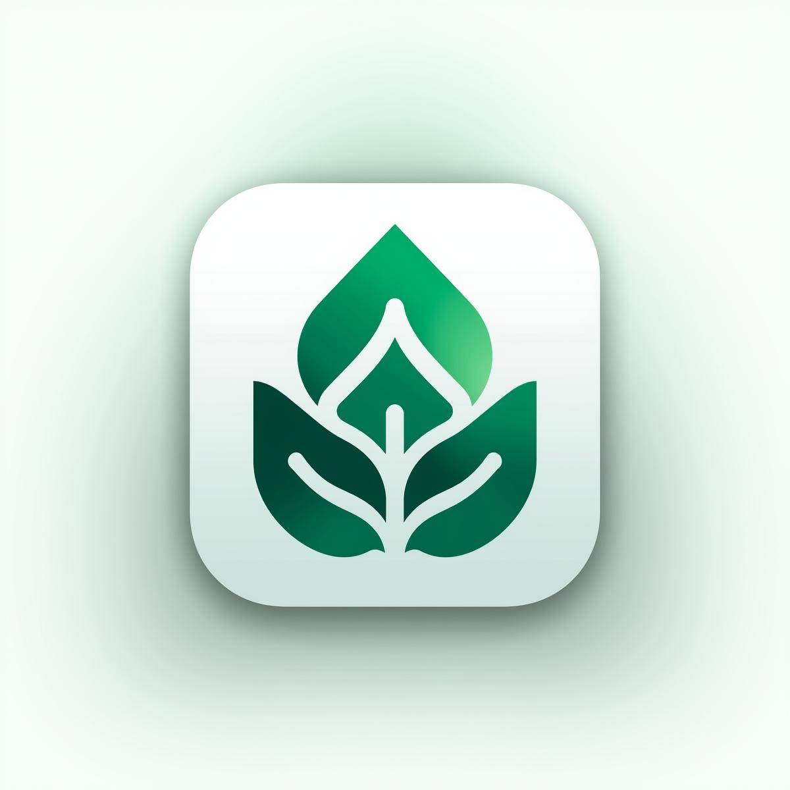

<div align="center">
  
  <h1>Agro Sosyal</h1>
  <p><strong>Tarladan geleceğe, aynı toplulukta.</strong></p>
  <p>Çiftçilerin, üreticilerin ve tarıma gönül verenlerin buluştuğu dijital topluluk.</p>
  <p>
    <a href="https://sehitumitkestitarimmtal.com/agrolink/">Web sitesini keşfet</a>
    &nbsp;·&nbsp;
    <a href="https://www.instagram.com/agrososyal.app?hvrq=MWRqanlmYWpqeDU4NQ==">Instagram’da takip et</a>
    &nbsp;·&nbsp;
    <a href="https://play.google.com/store/apps/details?id=com.yourcompany.agrolink">Google Play’den indir</a>
  </p>
</div>

---

## Tarımın buluşma noktası

Üretimin arkasında emek, tecrübe ve paylaşılacak nice hikâye var. **Agro Sosyal**, tarım dünyasından insanları bir araya getirerek deneyimlerin paylaşılmasına, yeni bağlantılar kurulmasına ve ürünlerin daha görünür olmasına yardımcı olur.

İster tarlasından öğrendiklerini paylaşan bir üretici, ister tarımı yakından takip eden biri ol; Agro Sosyal’de topluluğa katıl, keşfet ve bağlantıda kal.

> **Üretimini paylaş. Topluluğunu büyüt.**

## Agro Sosyal’de neler var?

- **Tarım topluluğu:** Gönderilerle deneyimlerini paylaş, diğer üreticileri ve tarım meraklılarını keşfet.
- **Ürün pazaryeri:** Tarımsal ürünleri incele, kendi ürünlerini sergile ve ilgilenen kişilerle iletişim kur.
- **Hikâyeler ve kısa videolar:** Tarımdan anları, fikirleri ve üretim sürecini toplulukla paylaş.
- **Topluluklar ve mesajlaşma:** Ortak ilgi alanları etrafında buluş, kullanıcılarla bağlantı kur.
- **Tarım odaklı araçlar:** Tarım dünyasına yönelik bilgi ve yardımcı özelliklere tek bir yerden ulaş.

Özelliklerin güncel kullanılabilirliği için [canlı siteyi](https://sehitumitkestitarimmtal.com/agrolink/) ziyaret edin.

## Agro Sosyal’i keşfet

| Platform | Bağlantı |
| --- | --- |
| Web sitesi | [sehitumitkestitarimmtal.com/agrolink](https://sehitumitkestitarimmtal.com/agrolink/) |
| Instagram | [@agrososyal.app](https://www.instagram.com/agrososyal.app?hvrq=MWRqanlmYWpqeDU4NQ==) |
| Android uygulaması | [Google Play’de Agro Sosyal](https://play.google.com/store/apps/details?id=com.yourcompany.agrolink) |

## Marka görseli

Depoda kullanılan Agro Sosyal logosu: [`public/agro.png`](public/agro.png).

## Geliştirici notları

Bu depo, Agro Sosyal web uygulamasının kaynak kodunu içerir. Proje React, TypeScript ve Vite ile hazırlanmıştır.

### Yerel çalıştırma

Gereksinimler: Node.js ve npm.

```bash
npm install
npm run dev
```

### Üretim derlemesi

```bash
npm run build
```

## Proje sahipliği

Resmî depodaki kaynak kodu ve yayınlanan değişiklikler depo sahibi tarafından yönetilir. Herkese açık olması, ziyaretçilere depoya doğrudan yazma yetkisi vermez.
